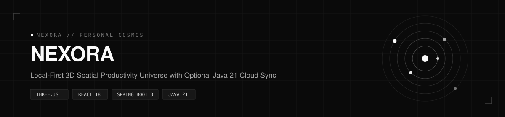
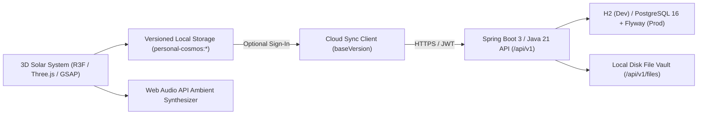

<div align="center">
  

  <br /><br />

  <p>
    
    
    
    
    
  </p>
</div>

---

## Overview

**Nexora (Personal Cosmos)** is an interactive 3D productivity universe built with **React 18**, **React Three Fiber / Three.js**, **GSAP 3**, and an optional **Spring Boot 3 (Java 21)** cloud synchronization backend.

Daily planning, wellbeing tracking, deep-work timers, knowledge notes, personal finance, and curated bookmarks are organized across **seven orbiting celestial worlds** inside an interactive solar system. The application runs **100% local-first** in the browser with offline PWA caching, and seamlessly upgrades to cross-device cloud sync and file storage when connected to the Java API.

---

## The Seven Productivity Worlds

| World | Domain | Key Capabilities |
| :--- | :--- | :--- |
| **Earth** | Daily Rhythm & Agenda | Interactive schedule timeline, inline-editable task list with category tags and undo, localized time-zone greetings. |
| **Moon** | Personal Wellbeing | Sleep duration and quality scoring with wave visualization, 8-glass daily hydration gauge, energy rhythm slider, and cycle tracker. |
| **Mars** | Knowledge Vault & Files | Tagged knowledge cards plus multipart file uploads (`<= 20 MB`) to the Java backend when signed in, with offline local fallback. |
| **Saturn** | Deep Work & Focus | Drift-resistant timestamp focus timer with desktop notifications, procedural Web Audio ambient noise (zero audio assets), and session history. |
| **Mercury** | Quick Capture & Checklists | Rapid item capture with priority levels, automated overdue indicator chips, and instant undo toast on deletion. |
| **Jupiter** | Financial Clarity | Multi-currency expense and income tracking (`USD`, `EUR`, `GBP`, `INR`, `JPY`, etc.), monthly budget thresholds, and category filters. |
| **Neptune** | Bookmarks Vault | Folder- and tag-organized bookmark manager with real-time search and native HTML bookmark importer (Chrome, Safari, Firefox). |

---

## Architecture & Technology Stack



### Frontend

- **UI & Routing:** React 18, Vite 6, `react-router-dom` (`/world/:planetId` deep links), GSAP 3 orbital camera transitions.
- **3D Graphics:** `@react-three/fiber`, `@react-three/drei`, `three` with runtime procedural canvas planet/cloud textures (`src/utils/planetTextures.js`).
- **Styling & Accessibility:** Custom glassmorphism CSS design system (`src/App.css`) + Tailwind CSS, ARIA dialog landmarks, `focus-trap-react`, keyboard navigation, and WCAG 2.1 verification via `@axe-core/playwright`.
- **Offline PWA:** `vite-plugin-pwa` service worker caching and versioned `localStorage` migrations (`src/utils/storageMigrations.js`).

### Optional Backend (Java 21)

- **Framework:** Spring Boot 3.3.5 (`server/`), targeting JDK 21+ with Maven Wrapper (`mvnw`).
- **Authentication:** Stateless HMAC-SHA256 JWT (`io.jsonwebtoken:jjwt`) and bcrypt password hashing.
- **Optimistic State Sync (`/api/v1/state`):** Per-user JSON document sync with `baseVersion` conflict detection (`HTTP 409`).
- **File Vault (`/api/v1/files`):** Authenticated multipart upload/download/delete up to `20 MB` with sanitized display filenames.
- **Persistence:** H2 in-memory database for development/testing; PostgreSQL 16 + Flyway (`V1__init.sql`) for production.

See [`server/README.md`](server/README.md) for the complete Java backend API reference and environment variables.

---

## Getting Started

### Prerequisites

- **Node.js** `>= 18`
- **JDK 21+** *(optional — required only for the Java cloud sync backend)*

### Option A: Local-First Frontend Only

```bash
npm install
npm run dev
```

Open `http://localhost:5173`. All seven worlds work offline using browser storage.

### Option B: Full Stack (Frontend + Java 21 Backend)

Terminal 1 — Start the Spring Boot API (`http://127.0.0.1:8080`):
```bash
npm run dev:api
```

Terminal 2 — Start the Vite dev server with `/api` proxy (`http://localhost:5173`):
```bash
npm run dev
```

### Option C: Docker Compose (PostgreSQL 16 + Java API + Nginx SPA)

```bash
docker compose up --build -d
```

- **Web SPA:** `http://localhost:80`
- **Java API:** `http://localhost:8080`
- **PostgreSQL:** `localhost:5432`

---

## Testing & Verification

```bash
npm run lint              # ESLint 9 across React, Vite, and Playwright specs
npm test                  # Vitest unit tests (formatting, storage migrations, backups)
npm run test:backend      # Spring Boot MockMvc integration tests (33 tests)
npm run test:e2e          # Playwright E2E + Axe WCAG 2.1 accessibility suite
E2E_BACKEND=1 npm run test:e2e   # Full-stack E2E with Java backend sync enabled
```

---

## Deployment & License

- **Static Frontend:** Pre-configured for **Vercel** (`vercel.json`) and **Netlify** (`netlify.toml`, `public/_redirects`).
- **License:** MIT
